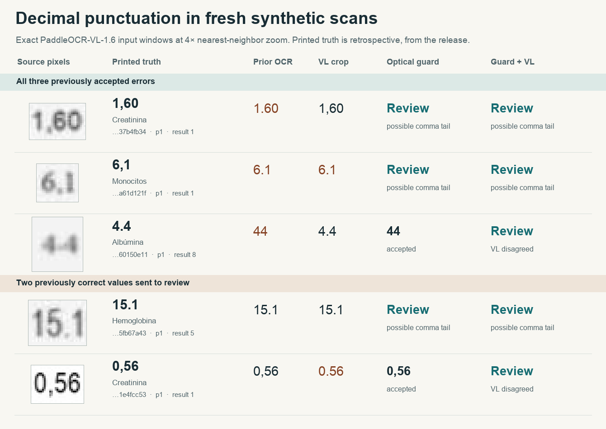

# Reading decimal marks in 80 synthetic laboratory reports

A printed albumin result of **4.4** became **44** in both conventional PaddleOCR readers. Both placed it on the correct row. PP-OCRv6 assigned the line a recognition score of 0.999859. This benchmark measures both whether the number belongs to the right test, and whether every character of the printed value survived extraction.

On this sample, PP-OCRv5 mobile with the Latin recognizer recovered 608 of 624 printed rows, and PP-OCRv6 medium recovered 607. V6 recovered three more exact rows on simulated photocopies. V5 used less time and memory on the same M4 Max, so we recommend v5 as the default for these upright synthetic pages. A second reader and optional punctuation checks let users trade automatic coverage for more manual review.

## Reproduce the scores

[Download the versioned dataset and its checksum](https://huggingface.co/datasets/AdrianPerez3/medextract-synthetic-lab-reports-starter/tree/9661d72f3b6163ad883699d02d225c565e04f587/benchmarks/ocr-punctuation-v1). From this repository, run the following with Python 3.11 or later. The archive includes the images, visible text, coordinate annotations and saved predictions from seven methods. Rescoring uses the Python standard library. It does not run the OCR models.

```sh
curl -fL 'https://huggingface.co/datasets/AdrianPerez3/medextract-synthetic-lab-reports-starter/resolve/9661d72f3b6163ad883699d02d225c565e04f587/benchmarks/ocr-punctuation-v1/benchmark.zip' -o benchmark.zip
python -c "import hashlib; from pathlib import Path; assert hashlib.sha256(Path('benchmark.zip').read_bytes()).hexdigest() == '8935c48385e80db321e9151995193408c8d71e4ada9b4653c7c88bf022c83f47', 'archive checksum mismatch'"
python scripts/score_ocr_benchmark.py benchmark.zip
python scripts/score_ocr_benchmark.py benchmark.zip --condition photocopy
```

To score your own extractor, supply one JSONL record per report ID, including reports where your extractor found zero rows. Each prediction needs the one-based page number, a point inside the test-name cell, a point inside the result-value cell and the literal value as a string. Both points use original JPEG pixels from the top left. The archive includes working examples in `predictions/`. [Scoring script](../../scripts/score_ocr_benchmark.py) · [Machine-readable results](ocr-punctuation-results.json)

```sh
python scripts/score_ocr_benchmark.py benchmark.zip --predictions my-predictions.jsonl
```

## Full-page OCR

Both engines used PaddleOCR 3.7.0, PaddleX 3.7.2 and PaddlePaddle 3.3.1. The same parser turned recognized words and boxes into test/value pairs. A distinct reference row earned credit only when both anchors fell in the correct cells of that row and the printed value matched exactly, including signs, decimal marks and trailing zeros. The metric does not require the test name to be spelled correctly. Precision divides exact rows by all submissions; recall divides by all expected rows, including misses and values withheld for review.

| Fresh cohort | Expected | V5 exact / emitted | V6 exact / emitted |
|---|---:|---:|---:|
| All 80 reports | 624 | 608 / 623 | 607 / 621 |
| Clean | 312 | 311 / 311 | 307 / 310 |
| Simulated photocopy | 312 | 297 / 312 | 300 / 311 |
| Original-design draw | 312 | 301 / 312 | 297 / 309 |
| Draw with alternate fonts and mixed decimal marks | 312 | 307 / 311 | 310 / 312 |

Relative to v5, v6 gained eight exact rows and lost nine. It reduced correctly associated comma/point substitutions from 14 to eight and produced five submissions with an anchor outside the target cell. V5 had zero such submissions. The difference in exact-row F1 was approximately zero. A paired 95% percentile bootstrap interval spanned −2.09 to +1.94 percentage points (5,000 resamples of whole reports, seed 173). This sample supports different error patterns and a speed comparison. It offers little evidence of an overall accuracy advantage.

| On the M4 Max | V5 mobile detector + Latin recognizer | V6 medium detector + medium recognizer |
|---|---:|---:|
| Median seconds/page | 2.94 | 6.29 |
| 95th percentile seconds/page | 4.22 | 9.46 |
| Peak worker RSS (GiB) | 2.59 | 4.73 |
| End-to-end seconds for 112 pages | 401.4 | 803.2 |

Both runs used one CPU worker at a time with two configured threads. Each worker processed up to eight pages. The wall times include loading the models and verifying checkpoints. The comparison uses the same 112 images, coordinates and runtime. Hardware, concurrency and document size affect these timings.

**Detector configuration.** A separate 20-report development pilot had 33 pages and 399 rows. We tested the conventional v6 medium weights with (a) the general OCR pipeline settings, (b) the detector's packaged thresholds at native page scale, and (c) those thresholds with the long edge capped at 960 pixels. The first two recovered the same 398 rows. The capped version recovered 396, introducing two comma-to-point substitutions. The predeclared tie-break selected (b). The fresh run used a 64-pixel minimum side, a 4,000-pixel maximum-side safeguard, a pixel threshold of 0.20, box threshold of 0.45 and box expansion of 1.40. V5 used the same side policy with 0.30, 0.60 and 1.50 respectively. Page orientation, dewarping and line rotation were off on these upright rasters. Both readers returned word boxes with a recognition cutoff of zero. [PaddleOCR release](https://github.com/PaddlePaddle/PaddleOCR/releases/tag/v3.7.0) · [PaddleX pipeline defaults](https://github.com/PaddlePaddle/PaddleX/blob/release/3.7/paddlex/configs/pipelines/OCR.yaml) · [V6 detector settings](https://huggingface.co/PaddlePaddle/PP-OCRv6_medium_det/blob/e42c869/inference.yml)

## What the review checks caught

The secondary workflow also read each physically upscaled 2× page using Tesseract 5.5.2, fast Spanish and English trained data, LSTM mode and page segmentation mode 6. The reader mapped its boxes back to the source image. The workflow checked row geometry and reread eligible disagreements on two crops with the same Latin v5 recognizer and Tesseract. Values sent to review did not count as automatically extracted.

| Workflow | Exact / accepted | Accepted errors | Automatic recall | Review entries | Additional correct values withheld vs. v5 + Tesseract |
|---|---:|---:|---:|---:|---:|
| V5 + Tesseract | 581 / 584 | 3 | 93.11% | 41 | — |
| V6 + Tesseract | 579 / 581 | 2 | 92.79% | 47 | — |
| V5 + Tesseract + optical check | 556 / 557 | 1 | 89.10% | 68 | 25 |
| V5 + Tesseract + VL check | 572 / 573 | 1 | 91.67% | 52 | 9 |
| V5 + Tesseract + both checks | 548 / 548 | 0 | 87.82% | 77 | 33 |

The optical check measures the printed mark's shape and vertical position relative to adjacent digits across several image-contrast thresholds. The VL check rereads accepted numeric crops with PaddleOCR-VL-1.6. A valid reading with the same signed digits but different punctuation triggers review. Neither check automatically edited a fresh value. The combined workflow sent all three previously accepted errors to review, together with 33 correct values. Its automatic F1 fell from 96.19% to 93.52% (paired 95% interval for the change, −3.91 to −1.62 percentage points). Review entries count proposals and can outnumber distinct affected rows. Human resolution time and eventual accuracy were unmeasured.

| Printed | V5 + Tesseract | VL crop | What caught it |
|---|---|---|---|
| `1,60` | `1.60` | `1,60` | Optical and VL checks |
| `6,1` | `6.1` | `6.1` | Optical check |
| `4.4` | `44` | `4.4` | VL check |

All three cases occurred on simulated photocopies. The figure includes two correct controls sent to review, so readers can see what a false alarm looks like.



**The larger model as a second reader.** Using unquantized BF16 weights on the M4 Max GPU through PyTorch MPS, the VL reader used the official `OCR:` prompt, greedy decoding and a 24-token limit. It read 560 of 584 previously accepted crop values exactly, with a median of 0.212 seconds per crop. That denominator includes only values already found and accepted by the baseline. It measures conditional transcription, not full-page detection or row association. Nine correct values sent to review by the VL rule were genuine commas. On a separate retrospective check of four previously misread decimal commas, the VL crop reader repeated all four wrong points. [PaddleOCR-VL-1.6 model card](https://huggingface.co/PaddlePaddle/PaddleOCR-VL-1.6)

**Why confidence alone was insufficient.** We traced each submitted number to its original recognition line. A score cutoff of 0.99 would have removed 136 correct v6 values and retained two incorrect ones, including the `44` above. This is a filter on already-emitted values. Rerunning detection or assembling tables after removing entire lines is a different experiment.

## Corpus and scope

Two fixed seeds (2026112403 and 2026112404) produced 40 independent synthetic report groups each, for 112 JPEGs in four layout families. Pages from one report stay together. Each report has one acquisition condition. The 40 clean and 40 simulated-photocopy reports are different cases. The second draw changed typefaces, mixed decimal marks within reports and increased photocopy degradation. Those changes occurred together. Its 31 reports containing both printed marks illustrate why enforcing a single report-wide decimal convention can damage a correct value. The 624 printed values include 183 commas, 159 points and 282 integers. No real patient documents were used.

**Known terminology error.** On 23 rows the synthetic display name `Oxígeno venoso` and unit `%` accompany LOINC `11556-8`, whose official meaning is oxygen **partial pressure** in blood. The original pixels and labels are preserved so users can reproduce the study. The archive lists every affected report and zero-based result index in `errata.jsonl`. Exclude these rows when evaluating terminology matching. The OCR scorer evaluates the cell positions and literal printed values. All 23 were correctly transcribed and associated by the conventional full-page readers. Simplified labels can omit specimen and method elsewhere too. Use these fixtures to evaluate document extraction. The numeric ranges and flags are synthetic and carry no clinical interpretation. [LOINC 11556-8](https://loinc.org/11556-8/)

This study covers upright synthetic laboratory tables with known geometry. It does not establish performance on real scans, phone photographs, unfamiliar layouts, clinical coding or decisions about patients. A follow-up measures what changed when each printed result was photocopied. [Paired 40-report study](paired-photocopy.md)
