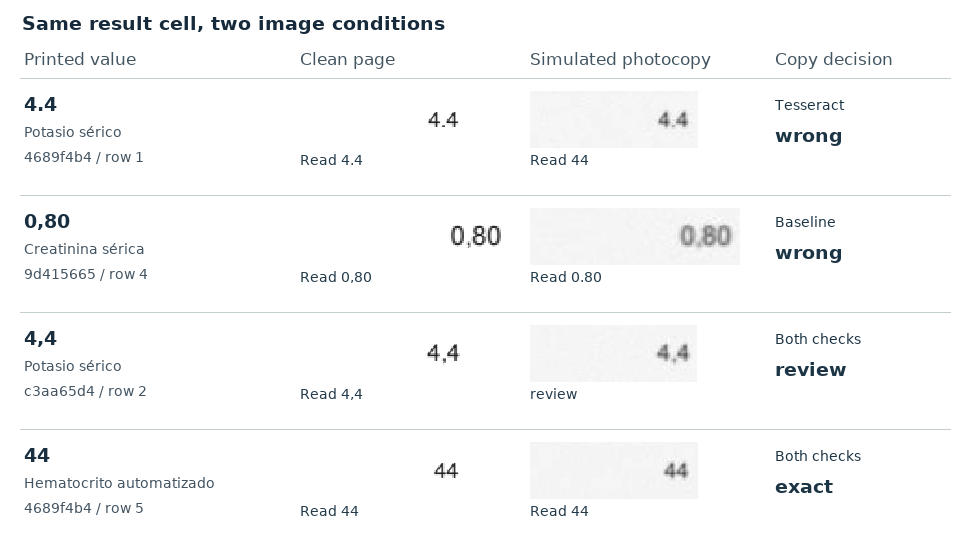

# What happens to a lab result after photocopying?

A missing decimal point can turn a potassium result of `4.4` into `44`. An OCR rule that always inserts a point can also damage a correctly printed `44`. To test both directions, we generated 40 Spanish-language laboratory reports that each contain a decimal potassium value and a genuine integer hematocrit. We read each page twice, once from the clean image and once from a simulated photocopy of that same image.

## Results on the same 280 rows

The two-reader baseline accepted 269 exact results and zero wrong strings on clean pages. On photocopies it accepted 225 exact results and four wrong strings. All four had been exact on their clean counterparts. Another 45 clean successes went to review on the photocopy, and five clean review cases became exact on the photocopy. That is a net loss of 44 exact results, or 15.7 percentage points of exact-row recall. Counting all accepted values, including wrong strings, automatic acceptance fell from 269/280 to 229/280 (14.3 percentage points).

| Reader or policy | Exact clean / 280 | Exact copy / 280 | Wrong, clean / copy | Clean exact → copy wrong / review / missing | Review entries, clean / copy |
|---|---:|---:|---:|---:|---:|
| PP-OCRv5 + table parser | 273 | 257 | 3 / 18 | 18 / 0 / 2 | 0 / 0 |
| Tesseract 2× + table parser | 263 | 213 | 16 / 45 | 36 / 0 / 20 | 0 / 0 |
| Two-reader baseline | 269 | 225 | 0 / 4 | 4 / 45 / 0 | 13 / 53 |
| Baseline + optical check | 265 | 204 | 0 / 0 | 0 / 68 / 0 | 17 / 78 |
| Baseline + VL check | 266 | 220 | 0 / 3 | 2 / 49 / 0 | 16 / 59 |
| Baseline + both checks | 262 | 199 | 0 / 0 | 0 / 70 / 0 | 20 / 83 |

Review entries measure work in the queue. Several proposals can refer to one row. For instance, the two-reader baseline sent 53 photocopy proposals to review, covering 51 distinct rows. The raw readers have no review policy. Their clean-exact to copy-missing figures count rows whose test and value could no longer both be located and accepted. [All counts and complete transition matrices](paired-photocopy-results.json)

**What the checks caught.** The four accepted photocopy errors changed `0,80`, `4,0`, `-0,8` and `+2,0` to point decimals. The numerical amounts were preserved, but all four strings misrepresented the printed mark. The optical check caught all four and withheld 21 other photocopy values the baseline had read correctly. That is 1.43 errors caught and 7.50 correct values withheld per 100 printed photocopy rows. It produced 78 review entries (27.9 per 100 rows). On clean pages it withheld four correct baseline values.

The VL check alone caught one of the four errors and withheld five correct photocopy values. Combining it with the optical check caught the same four errors as the optical check alone, while withholding another five correct photocopy values and three correct clean values. On this challenge, the optical check had the lowest review workload among policies that caught all four. In the earlier study, the VL check caught a dropped point that the optical check missed. Read these as complementary failure cases when choosing a review policy. [Earlier punctuation cases](ocr-punctuation.md#what-the-review-checks-caught)

**What happened to the integer controls.** On photocopies the baseline read 13/20 printed `4.4` values, 13/20 printed `4,4` values and 33/40 printed `44` values exactly. It withheld the rest. The optical and VL checks together accepted 8/20, 13/20 and 33/40 respectively, with the rest again sent to review. Tesseract alone emitted `44` for eight dot-decimal and eight comma-decimal potassium photocopies. Across all analytes it produced 31 copy values with a nonzero magnitude off by a power of ten, including two that also changed sign. V5 alone produced zero such magnitude changes on copies, although one clean `4,4` became `44` and 18 copy strings were wrong.



The figure enlarges the same value cell in each view. The labels below the cells show the selected workflow's saved output. Row numbers in the figure start at one. The JSON records use zero-based result indexes.

## Generate and inspect the 40 pairs

Install the repository's pinned Python 3.11 dependencies. From the repository root, run the following command. The output holds 40 clean PNGs, 40 photocopy JPEGs, 40 sets of printed labels and a coordinate sidecar for each view.

```sh
python -m pip install -r requirements.txt
python scripts/generate_paired_ocr_challenge.py paired-pages --seed 2026112405
```

Each pair shares the printed page, including the order of the seven rows and the previous-result column. The two views have distinct report IDs and a common `pair_id`, `group_id` and test split. Read `reports.jsonl` to locate a view's image and labels. The output's `pairing.json` records the rendering recipe and seed. The report identifiers, numerical values and layouts are synthetic. The Spanish test names identify the listed laboratory observations.

To measure photocopy effects on your own clean generator output, generate tier-0 images with coordinates and pass the resulting directory to the pairing tool. An input can have multiple pages. Both versions of every page stay in the same group and split.

```sh
python generate_complete_synthetic.py --count 2 --seed 42 --coordinates --tiers 1,0,0,0,0 --format jpg --output clean-reports
python scripts/make_paired_views.py clean-reports paired-reports --seed 42
```

The photocopy recipe converts to grayscale, samples a reduced resolution, applies blur, restores the original canvas size, varies the brightness across the page, adds noise and compresses to JPEG. It preserves the registered row and cell locations. Rotation, skew and perspective would require a corresponding coordinate transform.

## What was measured

The experiment uses four layout variants with ten independently seeded cases each and a fixed mix of seven rows per case. The 280 underlying rows produce 560 opportunities for transcription across the two views. Each source page includes a potassium `4.4` or `4,4`, a hematocrit `44`, a signed base-excess value, a creatinine value with a trailing zero, venous oxygen saturation and two other analytes. Each page also has previous values that can be mistaken for current results. The three source resolutions are 108, 144 and 180 DPI.

The OCR configuration and review rules were fixed before scoring. The conventional readers were PP-OCRv5 mobile detection with Latin mobile recognition and Tesseract 5.5.2 with fast Spanish and English models on a physical 2× enlargement (LSTM, PSM 6, 288 DPI). The baseline reconciles the two readers' predictions, checks their page locations and rereads eligible disagreements. The optical policy examines the shape of a possible separator. The vision-language (VL) policy reads accepted numeric crops with PaddleOCR-VL-1.6 in BF16 on Apple MPS. A difference in punctuation with the same signed digits can trigger review. The policies use predicted locations. Reference coordinates enter only at scoring time. [Earlier study and frozen reader settings](ocr-punctuation.md)

A row earns exact credit when the predicted test point and value point both fall in their respective cells on that row and the emitted value matches the visible string. Signs, trailing zeros, commas and points all count. A proposal sent for review earns no automatic credit. Comparing the two views of the same row isolates what changed under this simulated photocopy recipe.

## Replay the saved decisions

The [score-replay archive](paired-photocopy-replay.zip) contains the original manifest, printed labels, geometry, model settings, numeric crop readings and saved decisions. It supports an offline replay of the scores. Fresh inference with the exact historical adjudication pipeline requires its separate runtime and orchestration. Scoring it requires only the Python standard library. Run these commands from the repository root.

```sh
python -m zipfile -e docs/benchmarks/paired-photocopy-replay.zip paired-replay
python scripts/score_paired_ocr.py --manifest paired-replay/inputs/reports.jsonl --decisions paired-replay/decisions/both.jsonl --baseline paired-replay/decisions/combined.jsonl --summary
```

Omit `--summary` to inspect each source string, accepted value and review reason. To examine another method, substitute `paddle-only`, `tesseract-only`, `combined`, `guard` or `vl` for `both`. Image hashes in the manifest identify the evaluated rasters. A second run on the same machine reproduced every image and label byte for byte. Other operating systems and rendering-library builds can produce different pixels. Use the stored hashes to check your regenerated pages.

### Score another extractor

Use the same view IDs and submit one JSONL record for every view, including empty reports. Each point is an `[x, y]` pair measured in the original image from its top-left corner. A selected prediction contains `page` (one-based), `test_point`, `value_point` and `value_text` (the literal string). The following Python snippet constructs a record for one accepted result and one candidate your extractor withheld. Replace the example predictions with your extractor's outputs.

```python
import json

accepted = {"page": 1, "test_point": [115, 252], "value_point": [482, 252], "value_text": "-1.8"}
withheld = {"page": 1, "test_point": [115, 293], "value_point": [482, 293], "value_text": "44"}
record = {
    "report_id": "SYNPAIR_febd9cfecc788476_clean",
    "predictions": [accepted],
    "decisions": [
        {"status": "accepted", "selected": accepted},
        {"status": "review", "selected": None, "baseline": withheld, "reason": "uncertain"},
    ],
}
print(json.dumps(record, ensure_ascii=False))
```

The `predictions` list contains the accepted selections in decision order. The scorer counts a review proposal in the workload even when its anchors cannot identify a unique reference row. For a report with no proposals, both arrays are empty. Supply the resulting file to `--decisions`. Adding `--baseline` compares which previously accepted values the new workflow withheld.

## Terminology and scope

The new fixture labels venous oxygen saturation in percent with LOINC `2711-0`. The earlier 80-report study documented 23 percentage rows annotated with `11556-8`, which denotes oxygen partial pressure in blood. The published v1 benchmark carries that erratum. The test in this repository checks the new fixture's label, code and unit together. [Venous oxygen saturation](https://loinc.org/2711-0/) · [Oxygen partial pressure](https://loinc.org/11556-8/) · [Original benchmark erratum](ocr-punctuation.md#corpus-and-scope)

The [terminology lookup](paired-ocr-terminology.json) records the official LOINC 2.82 names and example units for all ten fixture codes. Original generated layouts and annotations are licensed under [CC BY 4.0](https://creativecommons.org/licenses/by/4.0/). LOINC content retains its [separate terms](../../licenses/LoincLicense_5.8.txt).

The challenge deliberately oversamples punctuation and uses upright pages with one table per report. It measures transcription, row association and review workload. Estimates for patient records, real scanner conditions, human review time and clinical performance require separate evidence.
